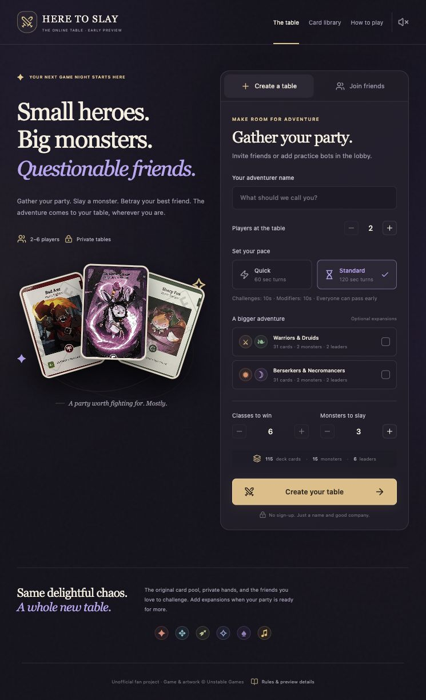

# Here to Slay Online

A Rust multiplayer backend and animated React frontend for private Here to Slay game nights.

**Current milestone: room → dice queue → party leader draft → dealt table.** This is the first development preview, not the complete card game. It supports real multiplayer rooms, private hands, accurate inventories, drawing, hand refresh, and timed turns. Card plays, challenges, modifiers, Hero/Leader effects, combat, and victory resolution are the next milestone; the interface does not pretend to execute them.



## Run locally

Requires Node.js 22.13+ and Rust 1.96+.

```bash
npm ci
npm run dev:all
```

Open **http://127.0.0.1:3000**. The frontend proxies `/api` and WebSockets to Rust on port 8080. The first Cargo build downloads and compiles the Rust dependencies.

Create a table, send its invitation link to another browser/device, and join with a different name. Guest seats are stored per tab, so two tabs can represent different test players. Refreshing a tab restores its seat. The localhost URL is for local testing; friends on other computers require a reachable deployment or LAN setup with matching allowed origins.

For solo practice, create a two-player table and select **Add practice bot** in the lobby. Ready up and roll for leaders. You can add up to five bots or mix them with friends, within your selected 2–6 total seats. The host can remove bots in the lobby; seats lock when drafting starts. Bots ready automatically, roll through ties, choose available leaders, and take paced turns on the server. Their current practice policy draws, refreshes a hand with no Heroes or at least eight cards, and passes; card plays and combat will follow the card engine. Bots use their own private snapshot and cannot see other hands or deck order.

For separate terminals:

```bash
npm run dev:server
```

```bash
npm run dev
```

The Rust server persists development rooms in ignored `backend/.slay-data/`. It owns the decks, random dice, turn clock, and all mutations; browser state is a personalized view only.

## Current behavior

- 2–6 seats; everyone readies before the host starts the draft.
- Host-managed practice bots fill existing seats, stay ready after setting changes, and work without a browser client. One human plus up to five bots is supported.
- Every player rolls two dice. Sort descending. Tied groups reroll internally, including repeated ties, without overtaking other groups.
- Draft leaders in that order. Leaders are unique; The Shadow Claw is excluded for two players.
- Last picker takes the first gameplay turn; later turns follow the original seating order.
- Deal five cards to each player and reveal three monsters. Only your own hand's card identities are transmitted to you.
- Draw costs 1 AP. Discarding the entire hand and drawing five costs 3 AP. End turn passes immediately. Exhausted main decks reshuffle the discard pile when needed.
- **Standard** (default): 120-second turns / 10-second challenges / 10-second modifiers.
- **Quick**: 60-second turns / 10-second challenges / 5-second modifiers.
- Turn deadlines are active now. Reaction windows are reserved for the next card-resolution milestone: they will pause the turn budget, end early after everyone passes, and reset after each modifier.
- Hosts can change settings only before drafting; changes clear ready states. Targets start at 6 classes or 3 monsters, with reachable upper bounds.

| Content | Main deck | Monsters | Leaders |
| --- | ---: | ---: | ---: |
| Base | 115 | 15 | 6 |
| Base + Warriors & Druids | 146 | 17 | 8 |
| Base + Berserkers & Necromancers | 146 | 17 | 8 |
| Base + both | 177 | 19 | 10 |

Refresh the pinned data with `npm run sync:catalog`, then run `npm run test:engine` to verify it. The compact browser catalog excludes unrelated expansions and source-only metadata.

The catalog snapshot comes from [the existing read-only API](https://github.com/EnmaSantos/here-to-slay-api). Release quantities create physical copies; reprints are not added together. The Charismatic Song's class is normalized to Bard. Rules/reference cards are not shuffled into playable decks.

## Architecture

- `backend/`: Rust, Axum, Tokio, Serde, SQLx, and a testable rules core.
- React/TypeScript/Vinext frontend with Motion transitions and a responsive card table.
- `lib/generated/`: TypeScript contracts generated from Rust using `ts-rs`; regenerate with `npm run test:engine`.
- REST commands use bearer guest-seat tokens, request IDs, and expected room versions. WebSockets authenticate in their first message, then send only personalized snapshots.
- Browser origins are checked for HTTP and WebSockets. Secret token hashes, other hands, and deck order never appear in RoomView.

## Persistence and deployment

Local development requires no cloud credentials. To use Supabase Postgres, supply `DATABASE_URL` to the Rust process. A session-pooler connection is suitable for this long-lived server. The checked-in `backend/migrations/001_rooms.sql` creates a private `slay_private.rooms` table with no browser access. No Supabase project settings or database tables have been changed by this initial milestone.

Set `FRONTEND_ORIGINS` to a comma-separated allowlist of exact browser origins. Configure `NEXT_PUBLIC_GAME_API_URL` when building the frontend for a separately deployed HTTPS Rust server. `.env.example` and `backend/.env.example` document these settings; Cargo does not automatically load .env files.

Build a native backend container:

```bash
docker build -t slay-server ./backend
```

The frontend retains the Sites build integration. Native Rust needs a separate service/container; a Sites-only publication is not a multiplayer backend. This preview is a **single-server deployment**: multi-instance coordination, retention, rate limiting, and production session recovery belong to the release milestone.

## Verify

```bash
npm run test:engine
npm run typecheck
npm test
```

With the Rust server running:

```bash
npm run test:api
```

The engine suite covers inventories/copies, nested and independent tie groups, last-picker-first, private hands, authorization, idempotency, and settings validation. The API suite walks real two-player and six-player rooms from lobby through dealing and turns. See [the roadmap](docs/ROADMAP.md) for the full agreed rule and release scope.

See [verification notes and table screenshots](docs/VERIFICATION.md) for this milestone's checked behavior and remaining limits.

## Artwork and sound

The wiki image URLs currently return HTTP 403. The preview uses clearly labeled original class/creature fallback portraits; official card text and source references remain in the catalog. Source artwork can be enabled with `NEXT_PUBLIC_USE_SOURCE_ART=1` when it is reachable. See [asset provenance and the generation prompt](docs/ASSETS.md).

The current optional interface chime is synthesized in Web Audio and muted by default. CC0 SFX and background music are planned, not bundled yet.

Here to Slay and its card text, characters, game concepts, and original artwork belong to Unstable Games. This is an unofficial fan project, without endorsement. The API software license does not extend to the game's content.
