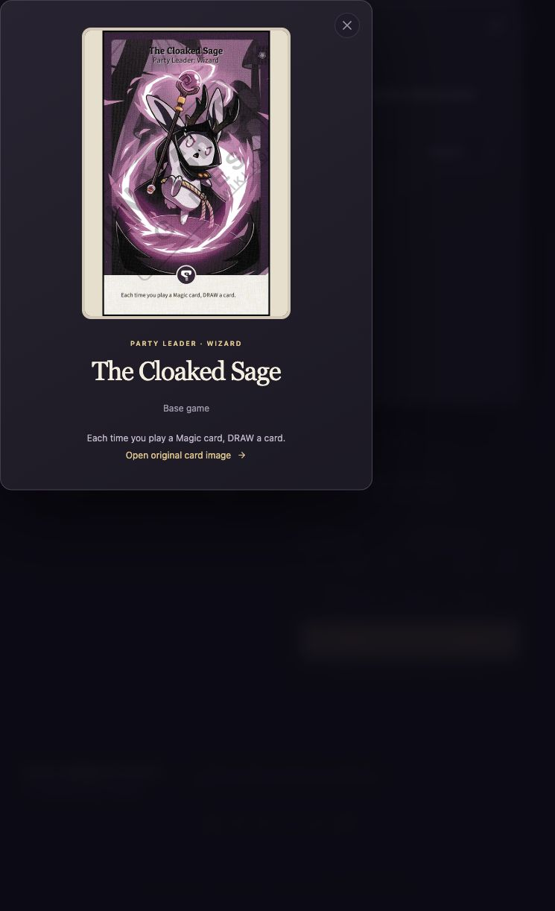
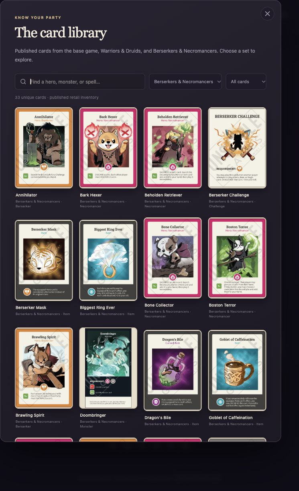
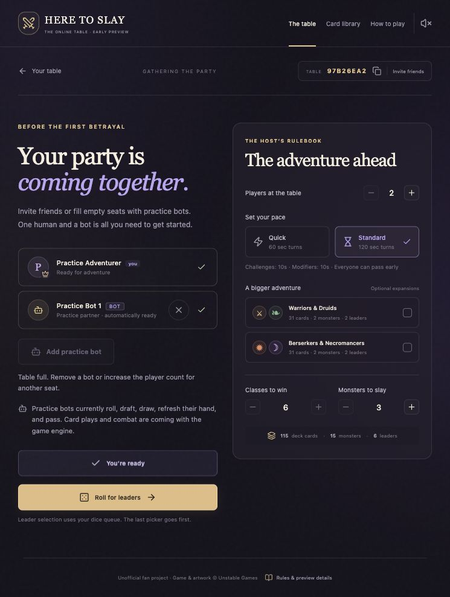
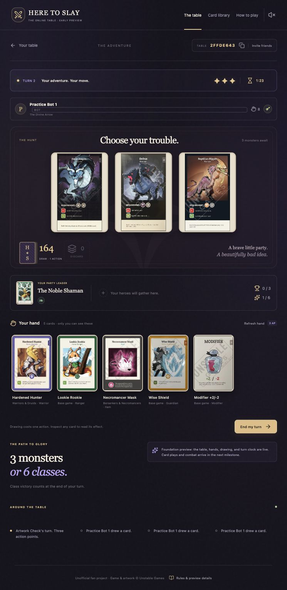
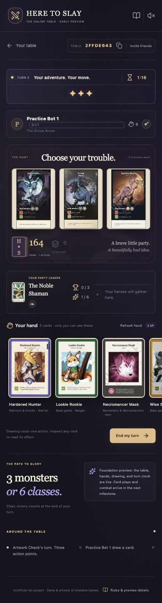

# Milestone verification

Checked locally on October 25, 2026. This verifies the room-to-table foundation, not the unimplemented card-resolution engine.

## Automated checks

- Rust engine: 21 passing tests, including generated-contract exports. Scenarios cover exact inventories, nested/repeated and independent tie groups, leader selection, last-picker-first, private hands, authorization, stale revisions, command idempotency, setting limits, host-managed bots, bots rerolling within their tied group, one human plus five bots completing setup and returning the turn to the human, and exclusion of unreviewed cards or changed quantities.
- Rust formatting and Clippy with warnings denied: pass.
- TypeScript typecheck: pass.
- Six catalog/image tests verify the reviewed 163-definition roster, exact copy counts, exclusion of injected/fan/promo entries, failed syncs for changed records, real image signatures, and rejection of security-check HTML.
- Complete local art audit: all 163 files pass source-identity, byte-count, format, resolution, and SHA-256 checks; no generated portraits remain. All 163 were also requested through the frontend over HTTP and returned matching image bytes.
- Production frontend build and an HTTP render through the actual local Worker runtime: pass. The page renders the room form without the old starter skeleton or private state.
- Live API: five passing tests covering two-player and six-player flows, concurrent independent room creation, mixed human/bot lobby management, and solo practice from setup through an automatic bot turn. Both expansions are enabled in the human room flows; dealing leaves exactly `177 - (5 × players)` main cards and 16 unrevealed monsters.

## Browser checks

Two browser clients created/joined a room, readied, rolled, selected distinct leaders, and reached the same table through WebSocket updates. Each received its own five-card hand. Refresh restored the host's seat and hand. Direct and frontend-proxied WebSocket connections returned authenticated personalized snapshots.

The phone layout was checked at 390 × 844, including all three monsters, the turn clock, private hand, and the card library. A library search for “Gnawing” returned The Gnawing Dread; inspection displayed its once-per-turn, 2 AP recovery text. Native dialog closing returned to the table. The responsive check caught and fixed an intrinsic grid-width issue.

The bot lobby was checked in the browser: add, remove, re-add, ready, roll, draft, and enter the table. The bot chose its own available leader and took its turn without a second client. Its ready status, BOT label, and remove control are visible; the 390px lobby has no horizontal overflow. API checks confirm bots cannot be added/removed after drafting starts and no bot actions continue after the host closes a room. A saved engine snapshot preserves pending automation, while snapshots from before bot support still load as human seats.

The library filters show 95 base-game definitions, 35 Warriors & Druids definitions, and 33 Berserkers & Necromancers definitions. Card inspection loads the local real image and links to the API image source. A room with both expansions rendered three real monster faces, a published expansion leader, and five real private-hand cards; all visible images loaded from `/cards/`. The 390px library and table had no horizontal overflow.

## Remaining limits

No public deployment or Supabase persistence connection was tested. Development uses ignored local snapshots; no cloud schema or project settings were changed. Native Rust requires its own reachable service for remote multiplayer.

Card plays, reactions, abilities, combat, and victory resolution are not implemented. Disconnect pauses, exact remaining-time recovery after server restart, guest recovery, retention, and public-service rate limiting remain on the roadmap. Music and third-party sound packs are not bundled yet.
